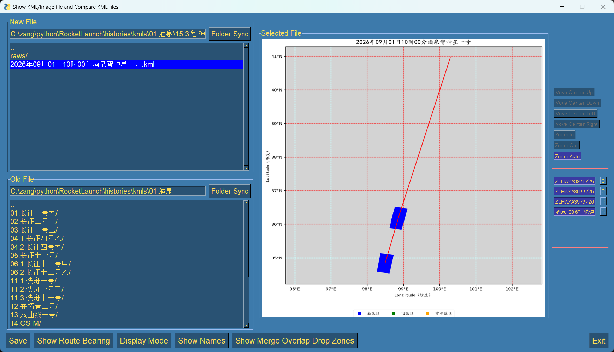
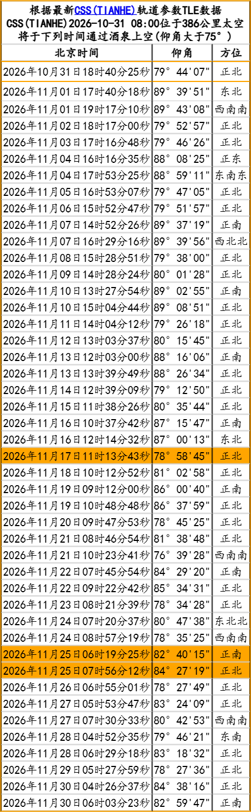

This repository include all Python scripts and windows batches to parse and predict China Launch Vehicles from NOTAM and MSA notices.

# 1. NOTAM
 Parse NOTAM for China Launch Vehicles and create KML and text files in folder [./temp](./temp)
 ```
2026/10/16  17:52             4,954 2026年10月21日11时36分黄海日照+近地轨道.kml
2026/10/16  17:52               228 2026年10月21日11时36分黄海日照+近地轨道.txt
2026/10/16  18:15             3,927 2026年10月22日10时58分文昌_海南_西昌+近地轨道.kml
2026/10/16  18:15               228 2026年10月22日10时58分文昌_海南_西昌+近地轨道.txt
2026/10/16  17:52             4,442 2026年10月22日11时00分文昌_海南_西昌_酒泉+近地轨道.kml
2026/10/16  17:52               228 2026年10月22日11时00分文昌_海南_西昌_酒泉+近地轨道.txt
2026/10/16  18:15             2,724 2026年10月24日03时00分东海上海_酒泉_黄海日照+近地轨道.kml
2026/10/16  18:15               228 2026年10月24日03时00分东海上海_酒泉_黄海日照+近地轨道.txt
2026/10/17  10:47               692 notam20261017-104734.txt
 ```

The notam20261017-104734.txt file looks like:
```
NOTAM发射预测
================================
01A: ZSHA,A5222/26,2026/10/21 03:29,2026/10/21 03:50;N35°23',E119°35'+20000
01B: ZSHA,A5223/26,2026/10/21 03:30,2026/10/21 03:54;N35°17',E120°11'|N35°00',E120°46'|N34°46',E120°36'|N35°05',E120°01'

02A: RPHI,B5549/26,2026/10/22 02:50,2026/10/22 03:15;N13°17',E115°55'|N13°38',E116°22'|N12°46',E117°03'|N12°26',E116°37'
02B: RPHI,B5550/26,2026/10/22 02:51,2026/10/22 03:26;N08°00',E119°57'|N08°26',E120°32'|N07°35',E121°13'|N07°28',E121°10'|N07°08',E120°44'|N07°08',E120°37'

03A: RJJJ,P5065/26,2026/10/23 18:00,2026/10/28 21:00;N30°43',E125°49'|N30°15',E126°36'|N29°48',E126°15'|N30°14',E125°33'
```


- Prase from [notams.aim.faa.gov/notamSearch](https://notams.aim.faa.gov/notamSearch/)
`python notam.py`

- Parse NOTAM from local file [./data/notam.txt](./data/notam.txt)
`python notam.py local`

- Parse MSA from local file [./data/msa.txt](./data/msa.txt)
`python notam.py local`

# 2. KML file 
- Compare KML file with historical files
`python compare.py new_kml_filename`
```
```

- Show KML files on map
`python showkml.py`


- Create Luanch Calendar
  The 202610.png will be saved to [./calendar](./calendar)
  `python cal.py 202610`
  

# 3. Machine Learning
 There are 4 models of RF(RandomForest), ET(ExtraTrees), GB(GradientBossting) and HGB(HistGradientBossting) in folder [./historical](./historical).
 ```
2026/10/16  17:48         4,419,563 feature-GEO_database.csv
2026/10/16  17:48        64,644,086 feature-GEO_target-BINARY_model-ET.pkl
2026/10/16  17:48         2,284,854 feature-GEO_target-BINARY_model-GB.pkl
2026/10/16  17:48         2,440,070 feature-GEO_target-BINARY_model-HGB.pkl
2026/10/16  17:48        22,319,782 feature-GEO_target-BINARY_model-RF.pkl
2026/10/16  17:48       192,818,489 feature-GEO_target-CLASSES_model-ET.pkl
2026/10/16  17:48        13,454,969 feature-GEO_target-CLASSES_model-GB.pkl
2026/10/16  17:48         9,180,393 feature-GEO_target-CLASSES_model-HGB.pkl
2026/10/16  17:48        96,109,241 feature-GEO_target-CLASSES_model-RF.pkl
2026/10/16  17:48         1,686,419 feature-IoU_database.csv
2026/10/16  17:48        16,970,507 feature-IoU_target-BINARY_model-ET.pkl
2026/10/16  17:48           896,923 feature-IoU_target-BINARY_model-GB.pkl
2026/10/16  17:48         1,049,195 feature-IoU_target-BINARY_model-HGB.pkl
2026/10/16  17:48        14,427,323 feature-IoU_target-BINARY_model-RF.pkl
2026/10/16  17:48            50,816 kml_names-GEO.csv
2026/10/16  17:48            50,816 kml_names-IoU.csv
 ```
- Create Models
`python ml.py build`

- Predict new launch kml file
`python ml.py predict new_kml_filename`

# 4 Create varivarious kinds of picture and video
```
Usage:
  plot                       :显示画面
  plot yao                   :显示现役火箭未使用遥号
  plot 年                    :生成年全部发射
  plot 年月                  :生成年月全部发射
  plot 年/年月 下记其他选项  :生成年其他选项发射
  plot 火箭名                :生成火箭发射
  plot 载荷名                :生成包含载荷名发射
  plot 发射地                :生成发射地发射
  plot regexp                :生成符合正则表达式发射
  plot 遥?                   :生成火箭发射遥?
  plot "^载荷名"             :生成载荷名开始的发射
  plot "?月"                 :生成?月发射
  plot 春节                  :生成春节前后发射
  plot 年初年末              :生成年初年末发射
  plot 首飞                  :生成首飞发射
  plot 空间站                :生成空间站相关发射
  plot 上面级                :生成上面级发射
  ```


- 

# 5. Others
- Parse html files saved in folder [./temp/nsf](./temp/nsf]) from [https://forum.nasaspaceflight.com/index.php?board=40.0](https://forum.nasaspaceflight.com/index.php?board=40.0)
```
2026/10/16  20:53            82,161 https___forum.nasaspaceflight.com_index.php_board=40.0.html
2026/10/16  20:53            84,954 https___forum.nasaspaceflight.com_index.php_board=40.50.html
2026/10/16  20:53            76,835 https___forum.nasaspaceflight.com_index.php_board=40.100.html
2026/10/16  20:53            81,519 https___forum.nasaspaceflight.com_index.php_board=40.150.html
2026/10/16  20:53            78,101 https___forum.nasaspaceflight.com_index.php_board=40.200.html
2026/10/16  20:55            81,249 https___forum.nasaspaceflight.com_index.php_board=40.250.html
2026/10/16  20:55            79,625 https___forum.nasaspaceflight.com_index.php_board=40.300.html
2026/10/16  20:55            84,082 https___forum.nasaspaceflight.com_index.php_board=40.350.html
2026/10/16  20:55            84,871 https___forum.nasaspaceflight.com_index.php_board=40.400.html
2026/10/16  20:55            85,236 https___forum.nasaspaceflight.com_index.php_board=40.450.html
2026/09/04  10:13            86,732 https___forum.nasaspaceflight.com_index.php_board=40.500.html
2026/09/04  10:13            88,949 https___forum.nasaspaceflight.com_index.php_board=40.550.html
2026/09/04  10:13            85,952 https___forum.nasaspaceflight.com_index.php_board=40.600.html
2026/09/04  10:13            84,953 https___forum.nasaspaceflight.com_index.php_board=40.650.html
2026/09/04  10:13            93,219 https___forum.nasaspaceflight.com_index.php_board=40.700.html
2026/09/04  10:13            89,908 https___forum.nasaspaceflight.com_index.php_board=40.750.html
2026/09/04  10:13            88,562 https___forum.nasaspaceflight.com_index.php_board=40.800.html
2026/09/04  10:13            85,788 https___forum.nasaspaceflight.com_index.php_board=40.850.html
2026/09/04  10:13            89,522 https___forum.nasaspaceflight.com_index.php_board=40.900.html
2026/09/04  10:13            87,856 https___forum.nasaspaceflight.com_index.php_board=40.950.html
2026/09/04  10:13            83,774 https___forum.nasaspaceflight.com_index.php_board=40.1000.html
2026/09/04  10:13            81,671 https___forum.nasaspaceflight.com_index.php_board=40.1050.html
2026/09/04  10:13            73,077 https___forum.nasaspaceflight.com_index.php_board=40.1100.html
2026/09/04  10:13            64,273 https___forum.nasaspaceflight.com_index.php_board=40.1150.html
```
`python nsf.py`
The [nsfLinkList.html](./temp/nsfLinkList.html) file created in folder [./temp/](./temp)

- Show Launch candidate Date and time of Shenzhou and Tianzhou spaceship.
`python css.py "酒泉:20261117,20261125"`
